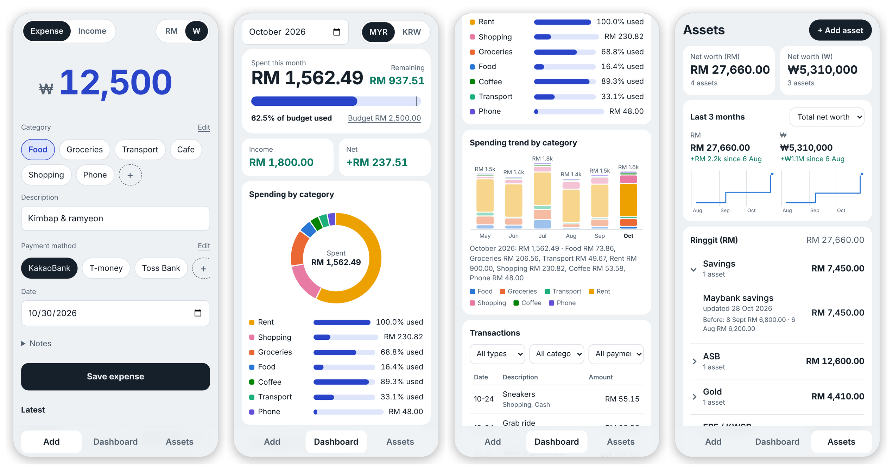
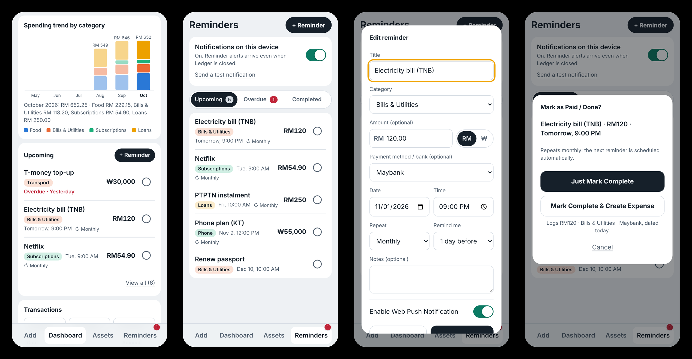
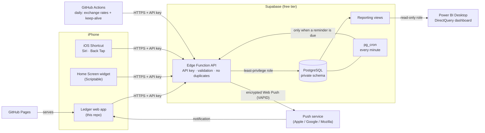

# Ledger

**A fast, private expense and net-worth tracker for life between Malaysia and Korea.**
Ringgit (RM) and Won (₩) are kept completely separate: their own categories, payment methods, budgets and totals. It lives on the iPhone Home Screen, updates in real time, and reminds you before bills are due with real push notifications.

<picture>
  <source media="(prefers-color-scheme: dark)" srcset="docs/screens-dark.png">
  
</picture>

<sub>Screenshots use made-up demo data.</sub>

---

## What it does

| | |
|---|---|
| **Log in seconds** | Big amount field that formats as you type (`₩204,800`, `RM 1,234.56`), category and payment-method chips, today's date by default. Notes stay folded away. |
| **Two currencies, never mixed** | Switch RM ↔ ₩ and the whole form changes: Malaysian banks and categories for RM, Korean ones for ₩. Totals are never added across currencies. |
| **Budgets that talk back** | A monthly budget per currency plus optional budgets per category. Bars show *% used* and turn red when you go over. |
| **Live dashboard** | Spent / remaining meter, a category doughnut, budget bars and a 6-month stacked trend. Pick any month; it refreshes every 15 seconds while open. |
| **Assets and net worth** | Savings accounts, ASB, gold, stocks, EPF… grouped by category with totals, a dated value history and RM / ₩ trend lines for the last 3 months. |
| **Bill reminders with notifications** | Bills, subscriptions, debt instalments and top-ups, filed under your own expense categories and payment methods (picking a ₩ category switches the reminder to ₩), once or repeating (daily to yearly). The server sends a push notification at the time you pick (or 10 min to 1 day before), even when Ledger is closed. Tap it to open that reminder. |
| **One tap from reminder to expense** | A reminder never counts as spending on its own. When you pay, **Mark Complete & Create Expense** logs the expense straight away with the reminder's title, amount, currency, category, payment method and notes, dated the day you pay. If something is missing, such as the amount, Ledger asks for just that. |
| **Works on a bad connection** | If the network drops, entries wait on the phone and send themselves later. A retried send can never create a duplicate. |
| **Everywhere on the iPhone** | Installable Home Screen app, a Scriptable Home / Lock Screen widget (`LedgerWidget.js`), and an iOS Shortcut for Siri or a double tap on the back of the phone. |

## Reminders

<picture>
  <source media="(prefers-color-scheme: dark)" srcset="docs/reminders-dark.png">
  
</picture>

- **Upcoming** on the dashboard shows the next 3 (overdue first), with *+ Reminder* and *View all*. The **Reminders** tab splits them into *Upcoming*, *Overdue* and *Completed*.
- **Mark as Paid / Done?** offers *Just Mark Complete* or *Mark Complete & Create Expense*. A logged expense shows as *✓ Logged* under *Completed*, and the toast has an *Undo*.
- **Repeating reminders** move on by themselves. Completing one schedules the next, and monthly ones keep their day (31 Jan → 28 Feb → 31 Mar). If you forget one, the next still arrives on time and the missed one waits under *Overdue*.
- **Notifications on iPhone** need iOS 16.4 or later, with Ledger added to the Home Screen and opened from there. In a Safari tab, or if notifications are blocked, the app explains what to do and reminders still show in the app.

## How it fits together



- **This repository** is only the client: the web app, the widget script and the daily GitHub Action. It is published with GitHub Pages.
- **The API and database** live in a separate, private project: a Deno Edge Function in front of Supabase Postgres. The phone never talks to the database directly. The API signs in with a role that can only run the app's own functions, and Power BI reads through a separate read-only role.
- **Reminders are scheduled on the server,** not in the browser. A database job checks every minute and calls the API only when a notification is due. The API sends it once per device and retries the next minute if the push service is briefly down. The app's service worker (`sw.js`) shows the notification and opens the right reminder when you tap it.
- **Exchange rates** (MYR ↔ KRW) come from the European Central Bank once a day and are stored with their date and source. Amounts are never converted with made-up rates.

## Charts

All charts are drawn by hand as SVG, with no chart library:

- **Category colours** come from your own category list, so a category keeps its colour as you add, rename or remove others. The 8-colour palette was checked for colour-blind separation in both light and dark mode. Categories beyond the 8th are grouped as *Other*.
- **Tap to read.** Tap a doughnut slice, a month in the trend chart, or drag across a net-worth line to see the exact value. Every chart also has a text breakdown or labelled rows, so nothing relies on colour alone.
- **Net-worth lines are steps,** because an asset's value only changes when you update it. The line starts at your first recorded value instead of jumping up from zero.

## Privacy and security

- **No secrets in this repo.** Its full history has been checked against the real keys and passwords. `config.js` holds only the public API address; the API key is typed in once on each device and kept in that browser's storage (or the iOS Keychain for the widget).
- **Every request needs the key.** Requests without it get `401`, and browsers may only call the API from the app's own web address (CORS).
- **Strict browser sandbox.** The page loads no third-party scripts, fonts or trackers, and its Content-Security-Policy blocks inline scripts and styles.
- **Push notifications are end-to-end encrypted** to each device (RFC 8291) and signed with a server-only key (VAPID). The API only sends to real browser push services, and the public key in `/meta` is the only push key the app ever sees.
- **GitHub Action secrets** (`EXPENSE_API_URL`, `EXPENSE_API_KEY`) are stored in the repository's encrypted *Secrets*, never in the workflow file.

## What's in this repo

| File | Purpose |
|---|---|
| `index.html` | App shell: entry form, dashboard, assets, reminders, dialogs |
| `app.js` | All app logic and the SVG charts (plain JavaScript, no build step) |
| `styles.css` | Layout, light and dark themes, chart palette |
| `sw.js` | Service worker: shows push notifications and opens the tapped reminder (no offline cache) |
| `config.js` | Public API address (no credentials) |
| `manifest.webmanifest`, `icon*.png`, `icon.svg` | Home Screen app install |
| `LedgerWidget.js` | Scriptable widget for the Home and Lock Screen |
| `.github/workflows/daily-keepalive-fx.yml` | Daily exchange-rate sync that also keeps the free database awake |
| `docs/` | README images |

## Running it

The app is a static site, with nothing to install or build:

```bash
python -m http.server 8080   # then open http://localhost:8080
```

On first launch it asks for the **API address** and **API key**. It needs a running instance of the private Ledger API, so without one you'll see the setup screen only.

### API used by the app

| Method | Path | Used for |
|---|---|---|
| `GET` | `/meta` | Currencies, and each currency's categories and payment methods |
| `POST` / `GET` | `/transactions` | Save (idempotent via `request_id`), list entries |
| `DELETE` | `/transactions/{id}` | Delete an entry |
| `GET` | `/summary?month=&currency=` | Dashboard numbers, category budgets, 6-month trend |
| `PUT` | `/budget`, `/category-budgets` | Monthly and per-category budgets |
| `POST` / `PATCH` / `DELETE` | `/categories`, `/payment-methods` | Manage your lists (per currency) |
| `GET` / `POST` | `/assets` | Assets with their value history, add an asset |
| `PATCH` / `DELETE` | `/assets/{id}` | Update a value (or its date), edit, delete |
| `POST` / `PATCH` / `DELETE` | `/asset-categories` | Manage asset categories |
| `GET` / `POST` | `/reminders` | Open + recently completed reminders, add one (idempotent via `request_id`) |
| `GET` / `PATCH` / `DELETE` | `/reminders/{id}` | Open, edit, delete a reminder |
| `POST` | `/reminders/{id}/complete` | Mark done; with `{"createExpense": true}` also logs the expense (once). Schedules the next one if it repeats |
| `POST` | `/reminders/{id}/reopen` | Undo "done" |
| `POST` / `DELETE` | `/push/subscriptions` | Turn notifications on / off for this device |
| `POST` | `/push/test` | Send a test notification |
| `GET` | `/health` | Uptime check (no key needed; says only up or down) |

### The daily workflow

`.github/workflows/daily-keepalive-fx.yml` runs every morning (08:17 KST). It fetches the day's exchange rates through the API, which also counts as activity so the free Supabase project isn't paused after 7 idle days. GitHub turns scheduled workflows off after 60 days without a commit; re-enable it from the **Actions** tab if that happens.

## Built with

Plain HTML, CSS and JavaScript · SVG · Supabase (PostgreSQL + Deno Edge Functions) · Power BI Desktop · Scriptable · GitHub Pages and Actions.
The private API is covered by automated tests: 45 API tests against a real PostgreSQL (including decrypting real push payloads and checking the VAPID signature), and more than 100 browser checks at iPhone size, including a push delivered to the real service worker.
